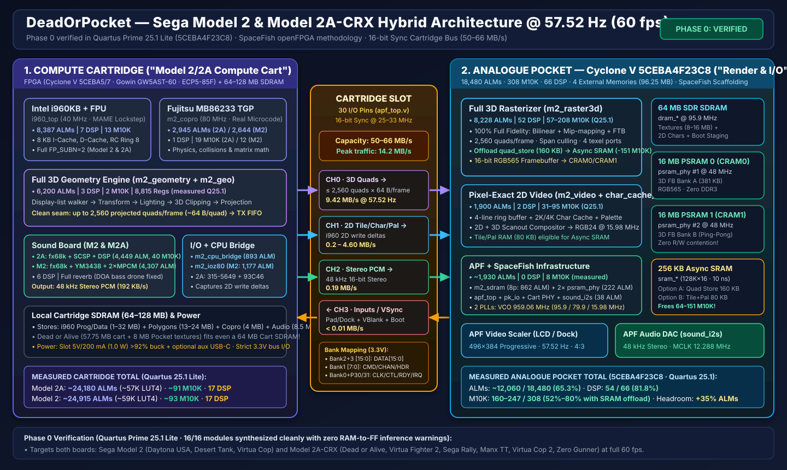
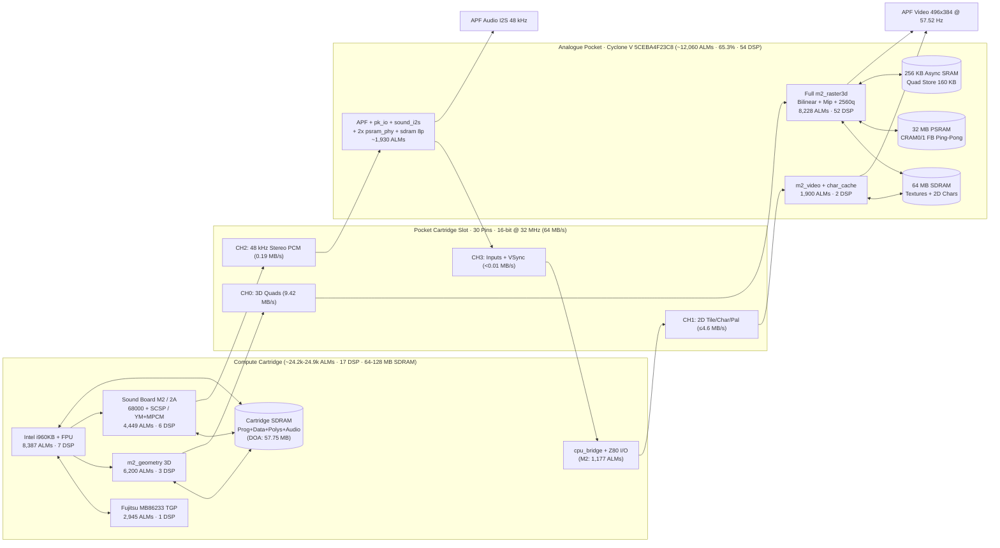

# DeadOrPocket

**Sega Model 2 & Model 2A-CRX @ 60 fps (57.52 Hz) for Analogue Pocket — Hybrid openFPGA Architecture**

Based on the [`alphanu1/sega-model2-mister`](https://github.com/alphanu1/sega-model2-mister) FPGA recreation (GPL-3.0) and built upon the openFPGA architecture and memory methodology proven in [`DanimanX/SpaceFish`](https://github.com/DanimanX/SpaceFish).



---

## Why a Hybrid Architecture? (Phase 0 Quartus 25.1 Verification)

The Analogue Pocket's main Intel Cyclone V FPGA (`5CEBA4F23C8`) provides **18,480 ALMs, 308 M10K blocks, and 66 DSP blocks** (~44% of the MiSTer DE10-Nano's logic fabric). After synthesizing all **16 real RTL subsystems** from both Model 2 (`main`) and Model 2A-CRX (`model2a`) in **Quartus Prime 25.1 Lite** targeting `5CEBA4F23C8` ([`phase0_bench/run_phase0.py`](phase0_bench/run_phase0.py)):

- **A monolithic single-chip port is physically impossible:** even with the entire MiSTer framework (`sys/`) stripped out, the core requires **~34,400–35,100 ALMs (~1.9× the Pocket)**, **~420+ M10K (~1.4×)**, and **~71 DSP (~1.1×)**.
- **Zero Quartus 25.1 regressions:** **16 / 16 modules** compiled cleanly with **0 RAM-to-flip-flop inference warnings**.
- **The "Compute-in-Cartridge / Render-in-Pocket" split fits cleanly at full 60 fps (57.52 Hz) with zero compromises:**
  - **Analogue Pocket (`5CEBA4F23C8`)** runs the **complete, unmodified 3D + 2D video pipeline** (`m2_raster3d` with bilinear filtering, mip-mapping, and 2,560 quads/frame + pixel-exact `m2_video`), stores textures in its **64 MB SDR SDRAM**, double-buffers the 16-bit RGB565 framebuffer in **ping-pong across both 16 MB Cellular PSRAMs (`cram0`/`cram1`)**, and offloads `m2_quad_store` (160 KB) to its **256 KB Async SRAM (`sram_*`)** — using only **~65.3% ALMs (12,062 / 18,480)** and **81.8% DSP (54 / 66)**.
  - **Compute Cartridge** (plugged into the Pocket's 30-pin cartridge slot) runs all game computation and audio (`i960KB + FPU`, `MB86233 TGP`, `m2_geometry`, `Sound Board M2/2A`, and `m2_ioz80`), streaming only **~14.2 MB/s peak** of projected quads, 2D deltas, and 48 kHz stereo PCM over a **16-bit synchronous bus @ 25–33 MHz (50–66 MB/s)**.

---

## System Dataflow



---

## Phase 0 Measured Synthesis Results (`5CEBA4F23C8` · Quartus Prime 25.1 Lite)

Measured directly via [`phase0_bench/run_phase0.py`](phase0_bench/run_phase0.py) (full raw JSON in [`phase0_bench/phase0_parsed.json`](phase0_bench/phase0_parsed.json)):

| RTL Subsystem | Branch | Est. ALMs | Registers | Block Mem Bits | Est. M10K | DSP | Hybrid Side |
|---|---|---:|---:|---:|---:|---:|---|
| `i960_top` (`FP_SUBN=2, RC_RING=1, DC=64`) | `model2a` | **8,387** | 4,519 | 98,304 | 13 | 7 | Cartridge |
| `m2_geometry` | `model2a` | **6,200** | 8,815 | 10,532 | 2 | 3 | Cartridge |
| `m2_copro` (MB86233 TGP) | `model2a` / `main` | **2,945** / 2,644 | 2,863 | 164,098 | 19 / 12 | 1 | Cartridge |
| `m2_2a_sound` (68k + SCSP + DSP) | `model2a` | **4,449** | 3,838 | 228,128 | 40 | 6 | Cartridge (2A) |
| `m2_sound_board` (68k + YM3438 + 2×MPCM) | `main` | **4,307** | 4,130 | 179,571 | 24 | 6 | Cartridge (M2) |
| `m2_ioz80` (TV80 I/O, Model 2 only) | `main` | **1,177** | 783 | 196,608 | 24 | 0 | Cartridge (M2) |
| `m2_cpu_bridge` | `model2a` | **893** | 911 | 169,984 | 17 | 0 | Cartridge |
| `m2_raster3d` (**full: bilinear + mip + 2560q**) | `model2a` | **8,228** | 9,724 | 1,944,156 | 208 *(57 w/ SRAM)* | 52 | **Pocket** |
| └ `m2_quad_store` *(isolated, SRAM offload target)* | `model2a` | *(728)* | *(465)* | *(1,484,800)* | *(151)* | *(0)* | **Pocket (`sram_*`)** |
| `m2_video` (2D tilemap, 4-line ring) | `model2a` | **1,598** | 2,296 | 122,880 | 16 | 2 | **Pocket** |
| `m2_char_cache` (2K lines) | `model2a` | **202** | 288 | 143,360 | 15 | 0 | **Pocket** |
| `m2_sdram` (8 ports) | `model2a` | **862** | 1,485 | 0 | 0 | 0 | **Pocket** |

See [`docs/ARCHITECTURE.md`](docs/ARCHITECTURE.md) for the complete technical specification: physical cartridge pinout (`apf_top.v`), bus protocol & bandwidth budget, 5V/200 mA power design, candidate cartridge FPGAs (`5CEBA5/7`, `GW5AST-60`, `ECP5-85F`), Cyclone V PLL clock synthesis (`clk_74a = 74.25 MHz`), and the deduplicated memory layout for *Dead or Alive* (57.75 MB cart + 8 MB Pocket textures).

---

## Target Games (Model 2 & Model 2A-CRX)

| Arcade Board | Target Titles |
|---|---|
| **Sega Model 2** | *Daytona USA* (Deluxe '93 & Rev A), *Desert Tank*, *Virtua Cop* |
| **Sega Model 2A-CRX** | *Dead or Alive*, *Virtua Fighter 2*, *Sega Rally Championship*, *Virtua Cop 2*, *Manx TT Superbike*, *Zero Gunner*, *Dynamite Cop*, *Motor Raid*, *Sky Target*, *Pilot Kids*, *Hanguk Pro Yagu 98* |

---

## Roadmap

- [x] **Phase 0:** Feasibility audit against SpaceFish + real Quartus Prime 25.1 Lite (`5CEBA4F23C8`) synthesis benchmark across all 16 Model 2 and Model 2A-CRX subsystems.
- [ ] **Phase 1 — Pocket Render Core (`src/fpga/`):** Port SpaceFish's APF scaffolding (`apf_top`, `m2_pll`, `m2_pk_io`, `psram_phy` ×2, `sound_i2s`) and integrate `m2_raster3d` + `m2_video` + `m2_quad_store` SRAM offload, validated on hardware with captured 3D/2D frame streams.
- [ ] **Phase 2 — Cartridge Bus Protocol (Verilator Co-Simulation):** Implement and verify the 16-bit synchronous packet bus (`CH0..CH3`) linking the Compute Cartridge RTL and Pocket Render RTL at 57.52 Hz.
- [ ] **Phase 3 — Compute Cartridge Hardware Prototype:** Finalize target cartridge FPGA (`5CEBA5/7`, `GW5AST-60`, or `ECP5-85F`), design the 32-pin Pocket cartridge PCB with 64–128 MB SDRAM, high-efficiency buck power stage, and strict 3.3V bus I/O.
- [ ] **Phase 4 — Hardware Bring-Up (Model 2A & Model 2):** Full 57.52 Hz hardware verification across *Dead or Alive*, *Virtua Fighter 2*, *Sega Rally*, and *Daytona USA* (handheld & Dock).

---

## Reproducing the Phase 0 Benchmark

Requirements: Intel Quartus Prime 25.1 Lite with Cyclone V support (`5CEBA4F23C8`) and Python 3.

```bash
git clone --depth 1 --branch main https://github.com/alphanu1/sega-model2-mister.git upstream/sega-model2-mister
git -C upstream/sega-model2-mister fetch --depth 1 origin model2a:model2a
git -C upstream/sega-model2-mister worktree add ../sega-model2a-mister model2a
python3 phase0_bench/run_phase0.py
```

---

## License & Credits

- Hybrid Analogue Pocket architecture & port: **DanimanX**.
- Upstream Sega Model 2 / Model 2A-CRX MiSTer core: **alphanu1** ([`alphanu1/sega-model2-mister`](https://github.com/alphanu1/sega-model2-mister)).
- Reference openFPGA scaffolding & Cellular PSRAM PHY: **SpaceFish** ([`DanimanX/SpaceFish`](https://github.com/DanimanX/SpaceFish)).
- Licensed under the **GNU General Public License v3.0 (GPL-3.0)**. This repository does not contain and will never contain ROM files.
