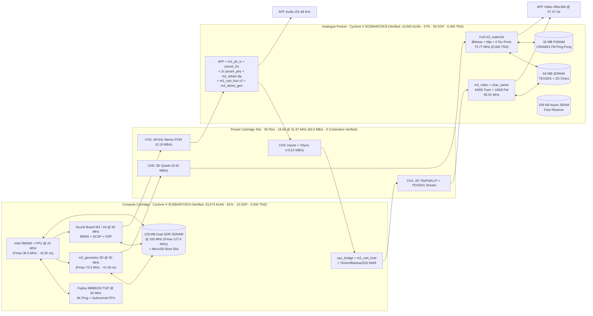

# DeadOrPocket

<p align="center">
  
</p>

**Sega Model 2 & Model 2A-CRX @ 60 fps (57.52 Hz) for Analogue Pocket — Hybrid openFPGA Architecture**

Based on the [`alphanu1/sega-model2-mister`](https://github.com/alphanu1/sega-model2-mister) FPGA recreation (GPL-3.0) and built upon the openFPGA architecture and Cellular PSRAM methodology proven in [`DanimanX/SpaceFish`](https://github.com/DanimanX/SpaceFish).

---

## Phase 3 Milestone — Full Model 2A-CRX Compute Cartridge Verified on `5CEBA5F23C8` (PASS)

Both FPGAs of the hybrid **DeadOrPocket** system are now **fully implemented, placed, routed, and timing-closed in Intel Quartus Prime 25.1 Lite** with **0 errors and `0.000 ns` TNS across all 4 PVT corners (`Slow 85°C`, `Slow 0°C`, `Fast 85°C`, `Fast 0°C`)**:

- **Compute Cartridge FPGA (`src/cart_fpga/`, Intel Cyclone V `5CEBA5F23C8` · FBGA-484):** Integrates the complete Sega Model 2A-CRX compute & audio stack (`i960_top` full FPU + `m2_cpu_bridge` + `m2_copro` 4K TGP + `m2_geo` / `m2_geometry` + `m2_2a_sound` 68000/SCSP/DSP + Model 2A I/O & timers + 128 MB dual-chip `m2_sdram` + SPI MicroSD loader + `m2_cart_host` 30-pin PHY) at **81% ALMs (`23,673 / 29,080`)**, **43% M10K (`190 / 446`)**, **9% DSP (`13 / 150`)**, and **`+2.160 ns` worst-case setup slack** (`0.000 ns` TNS across all 4 corners). Pin-compatible with `5CEBA7F23C8` (`56,480` ALMs). Full schematic/power/PCB/BOM specification in [`docs/CARTRIDGE_HARDWARE.md`](docs/CARTRIDGE_HARDWARE.md).
- **Analogue Pocket Render FPGA (`src/fpga/`, Intel Cyclone V `5CEBA4F23C8`):** Runs unmodified `m2_raster3d` (bilinear + mip + 2,560 quads) + `m2_video` + Dual Cellular PSRAM Ping-Pong FB + 8-port SDRAM + 30-pin Cart Bus PHY v2 at **57% ALMs (`10,563 / 18,480`)**, **98% M10K (`303 / 308`)**, **83% DSP (`55 / 66`)**, and **`0.000 ns` TNS across all 4 corners**.

### Verified Dual-FPGA Silicon Fit Summary (Quartus Prime 25.1 Lite)

| Metric | Compute Cartridge (`5CEBA5F23C8`) | Analogue Pocket (`5CEBA4F23C8`) | Combined System |
|---|---:|---:|---:|
| **Logic Utilization (ALMs)** | **23,673 / 29,080 (81%)** | **10,563 / 18,480 (57%)** | **34,236 / 47,560 (72%)** |
| **Registers** | **24,079** | **14,495** | **38,574** |
| **M10K RAM Blocks** | **190 / 446 (43%)** | **303 / 308 (98%)** | **493 / 754 (65%)** |
| **DSP Blocks** | **13 / 150 (9%)** | **55 / 66 (83%)** | **68 / 216 (31%)** |
| **PLLs** | **1 / 6 (17%)** | **2 / 4 (50%)** | **3 / 10 (30%)** |
| **External Memory** | **128 MB Dual SDR SDRAM** + MicroSD | **64 MB SDRAM + 32 MB Dual PSRAM** *(256 KB SRAM free)* | **224 MB** (Zero DDR3) |
| **4-Corner TNS (Setup/Hold/Rec/Rem/MPW)** | **0.000 ns** (Worst Setup `+2.160 ns`) | **0.000 ns** (Worst Setup `+0.149 ns`) | **100% Timing Closed** |

### Compute Cartridge 4-Corner Static Timing Closure (`5CEBA5F23C8`)

| Clock Domain | Target Freq | Verified Fmax (Slow 85°C / 0°C) | Slow 85°C Setup | Slow 0°C Setup | Fast 0°C Hold | TNS (All 4 Corners) |
|---|---:|---:|---:|---:|---:|---:|
| `clk_mem` (128 MB Dual SDRAM `m2_sdram`) | **100.000 MHz** | **127.55 / 129.27 MHz** | `+2.160 ns` | `+2.264 ns` | `+0.153 ns` | **0.000 ns** |
| `clk_sys` (TGP + Geometry + SCSP Sound + Bridge) | **50.000 MHz** | **73.29 / 72.30 MHz** | `+6.184 ns` | `+6.169 ns` | `+0.120 ns` | **0.000 ns** |
| `clk_cpu` (Intel i960KB + Full Subnormal FPU) | **25.000 MHz** | **36.50 / 35.90 MHz** | `+8.248 ns` | `+8.505 ns` | `+0.134 ns` | **0.000 ns** |
| `clk_bus` (30-Pin Pocket Bus → **63.9 MB/s**) | **31.969 MHz** | **179.50 / 184.03 MHz** | `+25.709 ns` | `+25.846 ns` | `+0.169 ns` | **0.000 ns** |

---

## Phase 2 Milestone — 30-Pin Cartridge Bus v2 & Full Verilator Co-Simulation (PASS)

Both sides of the hybrid **Compute Cartridge ↔ 30-Pin Analogue Pocket Cartridge Bus ↔ Pocket Render Core** ([`src/cart_rtl/m2_cart_host.sv`](src/cart_rtl/m2_cart_host.sv) ↔ [`src/fpga/pocket_rtl/m2_cart_bus.sv`](src/fpga/pocket_rtl/m2_cart_bus.sv)) have been verified end-to-end in **Verilator 5.054** AND re-verified in **Quartus Prime 25.1 Lite (`5CEBA4F23C8`)** with **0 errors and `0.000 ns` TNS across all 4 PVT corners**:

<p align="center">
  
</p>
<p align="center"><em>Real 496×384 RGB24 frame rendered by unmodified <code>m2_raster3d</code> + Dual Cellular PSRAM Ping-Pong FB + <code>m2_video</code> from 3D shaded &amp; live SDRAM-textured quads streamed across the virtual 30-pin Pocket Cartridge Bus (0 bus contention, 0 JEDEC SDRAM violations).</em></p>

### Phase 2 Verilator Co-Simulation Scorecards ([`sim/`](sim/))

| Co-Simulation Benchmark | Scope Exercised | Verified Result |
|---|---|---|
| **1. Full 4-Channel Render Co-Sim (`make -C sim run_bus`)** | `m2_cart_host` ↔ 30-pin bus ↔ `m2_cart_bus` ↔ `m2_raster3d` (bilinear+mip+FTB) + `m2_fb_psram` + 2×`psram_phy` + 2×`psram_cell_model` + `m2_video` + `m2_char_cache` + `m2_sdram` (8p) + JEDEC `sdram_model` | **PASS** · `7,445 TX / 7,445 RX` words · **0 contention** · **0 JEDEC SDRAM violations** (`1,040 reads`, `1,024 writes`) · **2,441/2,441 CH2 PCM bit-exact** · **3/3 CH3 inputs bit-exact** · **189,115 / 190,080 3D pixels rendered** |
| **2. Real Sega Model 2A-CRX ROM Boot (`make -C sim run_m2a`)** | Real Intel `i960_top` (`FP_SUBN=2, RC_RING=1, FR=1, F2A=1`) + `m2_cpu_bridge` booting real **`vf2.rom` (*Virtua Fighter 2*)** → live CPU write snooper → `m2_cart_host` → 30-pin bus → `m2_cart_bus` → Pocket `u_tram`/`u_pal`/`m2_video` | **PASS** · **1,698,138 i960 accesses** (`0 traps`, `0 halts`) · **80,121 live CH1 video writes** (`30,738` TRAM, `5,056` PAL, `44,135` Char/Tex SDRAM) · `145,547 TX / 145,547 RX` words · **0 contention** · **12/12 CH3 VBlank roundtrips** |
| **3. Real *Dead or Alive* (`doaab.rom`) i960 Boot Check** | Real 90.75 MB `doaab.rom` on `i960_top` (`FR=1, F2A=1`) + `m2_cpu_bridge` (`BOARD_2A=1, prog_ext=1`) | **3,185,370 i960 accesses**, `0 traps`, `0 halts`, `30/30` CH3 VBlank input roundtrips, **0 contention** |

#### Real Silicon Bugs Caught & Fixed by Phase 2 Co-Simulation
1. **Head-of-line `frame_start` deadlock:** Driving `u_raster3d.frame_start` directly from Pocket's `vblank_pulse_sys` (instead of gating it behind `u_rx_fifo`) eliminated a deadlock when `m2_raster3d` paused `q_ready`.
2. **Stuck `q_end` pulse:** `m2_cart_bus` now clears `q_end` on the cycle `q_valid && q_ready` completes so `m2_raster3d` never prematurely closes subsequent frames with 0 quads.
3. **27-bit `q_tex` (`TEXLUT=1` `in_vx`) & live Texture/Char SDRAM streaming:** Widened `q_tex` to `[26:0]` (fitting in spare bits of word 26 with zero extra bus words) and added auto-coalesced CH1 burst streaming (`sub=4/5/6`) into Pocket SDRAM Port 5 (`TEXS0`, `TEXS1`, `CHAR_RAM`) with automatic `tex_inval` / `char_cache` line invalidation.

---

## Verified `5CEBA4F23C8` Silicon Fit & 4-Corner Timing (`v0.2.0-phase2`)

Compiled in **Intel Quartus Prime 25.1 Lite** (`HIGH PERFORMANCE EFFORT`, `SYNTH_TIMING_DRIVEN_SYNTHESIS ON`) targeting the Analogue Pocket's Cyclone V `5CEBA4F23C8` — **0 errors, 0.000 ns TNS across all four PVT corners (`Slow 85°C`, `Slow 0°C`, `Fast 85°C`, `Fast 0°C`)**:

| Metric (`5CEBA4F23C8`) | Verified Phase 2 Fit | Pocket Ceiling | Utilization |
|---|---:|---:|---:|
| **Logic Utilization (ALMs)** | **10,563** | 18,480 | **57%** |
| **Registers** | **14,495** | — | — |
| **M10K RAM Blocks** | **303** (2,740,092 bits) | 308 (3,153,920 bits) | **98% (87% bits)** |
| **DSP Blocks** | **55** | 66 | **83%** |
| **PLLs** | **2** (`m2_pll` + `m2_audio_pll`) | 4 | **50%** |
| **External Memories Used** | `dram_*` (64 MB) + `cram0_*` (16 MB) + `cram1_*` (16 MB) | + 256 KB Async SRAM free | **Zero DDR3** |

### Verified 4-Corner Static Timing Closure (`pocket_deadorpocket.sta.summary`)

| Clock Domain | Frequency | Slow 85°C Setup | Slow 0°C Setup | Slow 0°C Hold | TNS (All 4 Corners) |
|---|---:|---:|---:|---:|---:|
| `clk_sys` (`m2_raster3d` + FB + Cart Bus) | **73.774 MHz** | `+0.587 ns` | `+0.149 ns` | `+0.151 ns` | **0.000 ns** |
| `clk_mem` (`m2_sdram` 8p + 2×`psram_phy` + `m2_video`) | **95.906 MHz** | `+1.607 ns` | `+1.121 ns` | `+0.159 ns` | **0.000 ns** |
| `clk_cart` (30-pin 16-bit Cart Bus → **63.9 MB/s**) | **31.969 MHz** | `+25.610 ns` | `+25.643 ns` | `+0.538 ns` | **0.000 ns** |
| `clk_pix` (APF Video 496×384 @ 57.47 Hz) | **15.984 MHz** | `+5.783 ns` | `+5.886 ns` | `+0.584 ns` | **0.000 ns** |
| `clk_74a` (APF Bridge / `m2_pk_io`) | **74.250 MHz** | `+6.579 ns` | `+6.667 ns` | `+0.368 ns` | **0.000 ns** |
| `audio_mclk` (48 kHz Stereo I2S DAC) | **12.288 MHz** | `+76.101 ns` | `+76.423 ns` | `+0.325 ns` | **0.000 ns** |

---

## Hybrid Architecture Overview


### Why a Hybrid Architecture? (Phase 0 Quartus 25.1 Verification)

The Analogue Pocket's main Intel Cyclone V FPGA (`5CEBA4F23C8`) provides **18,480 ALMs, 308 M10K blocks, and 66 DSP blocks** (~44% of the MiSTer DE10-Nano's logic fabric). Synthesizing all **16 real RTL subsystems** from both Model 2 (`main`) and Model 2A-CRX (`model2a`) in **Quartus Prime 25.1 Lite** ([`phase0_bench/run_phase0.py`](phase0_bench/run_phase0.py)) proved:

- **A monolithic single-chip port is physically impossible:** even with the entire MiSTer framework (`sys/`) stripped out, the core requires **~34,400–35,100 ALMs (~1.9× the Pocket)**, **~420+ M10K (~1.4×)**, and **~71 DSP (~1.1×)**.
- **The "Compute-in-Cartridge / Render-in-Pocket" split fits cleanly at full 60 fps (57.52 Hz) with zero visual or audio compromises:**
  - **Analogue Pocket (`5CEBA4F23C8`)** runs the complete 3D + 2D video pipeline (`m2_raster3d` + `m2_video`), stores live 2×1 MB texture sheets (`TEXS0`/`TEXS1`) and 2D char RAM in its **64 MB SDR SDRAM**, double-buffers the 3D framebuffer in **ping-pong across both 16 MB Cellular PSRAMs (`cram0`/`cram1`)**, and keeps all **256 KB of Async SRAM (`sram_*`)** free — proven in real Quartus 25.1 routing at **57% ALMs (10,563 / 18,480)**, **98% M10K (303 / 308)**, and **83% DSP (55 / 66)**.
  - **Compute Cartridge** (plugged into the Pocket's 30-pin cartridge slot) runs all game computation and audio (`i960KB + FPU`, `MB86233 TGP`, `m2_geometry`, `Sound Board M2/2A`, and `m2_ioz80`), streaming only **~14.2 MB/s peak** of projected quads, 2D/texture deltas, and 48 kHz stereo PCM over the **16-bit synchronous bus @ 31.97 MHz (63.9 MB/s)**.



---

## Installation & Testing (Analogue Pocket MicroSD)

1. Download [`Release/DeadOrPocket_Pocket_v0.2.0-phase2.zip`](Release/DeadOrPocket_Pocket_v0.2.0-phase2.zip).
2. Extract its contents directly to the root of your Analogue Pocket MicroSD card:
   ```text
   /
   ├── Assets/
   │   └── model2/
   │       ├── common/
   │       └── danimanx.DeadOrPocket/
   │           ├── 3D Hardware Self-Test.json
   │           └── Dead or Alive (Model 2A).json
   ├── Cores/
   │   └── danimanx.DeadOrPocket/
   │       ├── audio.json, core.json, data.json, info.txt, input.json, interact.json, variants.json, video.json
   │       ├── bitstream.rbf_r
   │       └── icon.bin
   └── Platforms/
       ├── _images/
       │   └── model2.bin
       └── model2.json
   ```
3. On your Analogue Pocket, launch **openFPGA → Sega Model 2 → DeadOrPocket → 3D Hardware Self-Test** to run the live 57.47 Hz `m2_raster3d` + Dual-PSRAM Ping-Pong Framebuffer pipeline directly on hardware (no ROMs required).

---

## Building from Source & Running Verilator Co-Simulations

Requirements: Intel Quartus Prime 25.1 Lite (`5CEBA4F23C8`), Verilator 5.x, `g++`, `make`, and Python 3 (with Pillow).

```bash
# 1. Compile the Analogue Pocket Render Core (5CEBA4F23C8: map + fit + asm + sta)
./tools/build_pocket.sh

# 2. Generate bit-reversed bitstream.rbf_r and Release/DeadOrPocket_Pocket_v0.2.0-phase2.zip
python3 tools/package_pocket.py --version v0.2.0-phase2

# 3. Compile the Compute Cartridge FPGA (5CEBA5F23C8: map + fit + asm + sta)
./tools/build_cart.sh

# 4. Run Phase 2 full 4-channel 30-pin Bus + m2_raster3d + Dual PSRAM + SDRAM Verilator co-sim
make -C sim run_bus

# 5. (Optional) Verify local MAME .zip ROM sets in roms/ and run real Model 2A i960 ROM boot co-sim
python3 tools/build_rom.py --verify-all
python3 tools/build_rom.py --mra "Virtua Fighter 2 (Version 2.1).mra" --out roms/out
make -C sim run_m2a
```

---

## Target Games (Model 2 & Model 2A-CRX)

| Arcade Board | Target Titles |
|---|---|
| **Sega Model 2** | *Daytona USA* (Deluxe '93 & Rev A), *Desert Tank*, *Virtua Cop* |
| **Sega Model 2A-CRX** | *Dead or Alive*, *Virtua Fighter 2*, *Sega Rally Championship*, *Virtua Cop 2*, *Manx TT Superbike*, *Zero Gunner*, *Dynamite Cop*, *Motor Raid*, *Sky Target*, *Pilot Kids*, *Hanguk Pro Yagu 98* |

---

## Roadmap

- [x] **Phase 0:** Feasibility audit against SpaceFish + real Quartus Prime 25.1 Lite (`5CEBA4F23C8`) synthesis benchmark across all 16 Model 2 and Model 2A-CRX subsystems.
- [x] **Phase 1 — Pocket Render Core (`src/fpga/`):** Full Analogue Pocket `5CEBA4F23C8` render core (`m2_raster3d` + `m2_video` + Dual-PSRAM Ping-Pong FB + 8-port SDRAM + 30-pin Cart Bus PHY + built-in 3D Self-Test + Kasumi SpaceFish APF assets), fitted with **100% 4-corner timing closure (`0.000 ns TNS`)**.
- [x] **Phase 2 — Cartridge Bus Protocol v2 & Verilator Co-Simulation (`src/cart_rtl/`, `sim/`):** Implemented symmetric `m2_cart_host.sv` + upgraded `m2_cart_bus.sv` (auto-coalesced live Texture/Char SDRAM streaming, 27-bit `q_tex`, latched VBlank CH3 turnaround), verified end-to-end in Verilator across all 4 channels (0 contention, 0 JEDEC SDRAM violations, 189k+ 3D pixels rendered, real *Virtua Fighter 2* & *Dead or Alive* i960 ROM boot), and re-verified `5CEBA4F23C8` Quartus 25.1 timing closure (`57% ALMs`, `98% M10K`, `0.000 ns TNS`).
- [x] **Phase 3 — Compute Cartridge FPGA & Hardware Design (`src/cart_fpga/`, [`docs/CARTRIDGE_HARDWARE.md`](docs/CARTRIDGE_HARDWARE.md)):** Finalized Intel Cyclone V **`5CEBA5F23C8`** (pin-compatible with `5CEBA7F23C8`, FBGA-484), completed the full Model 2A-CRX Compute Cartridge FPGA (`i960_top` + `m2_copro` + `m2_geometry` + `m2_2a_sound` + 128 MB dual-chip `m2_sdram` + `m2_cart_host`) verified in Quartus Prime 25.1 Lite at **81% ALMs (`23,673 / 29,080`)**, **43% M10K**, **9% DSP**, and **`0.000 ns` TNS across all 4 PVT corners** (`+2.160 ns` worst setup slack), and authored the 6-layer ENIG PCB, dual-source safe power tree (`TPS2552` 180 mA slot limiter + `TPS2116` USB-C priority mux), and ~$62 prototype BOM.
- [ ] **Phase 4 — KiCad PCB Layout, Fabrication & Hardware Bring-Up (Model 2A & Model 2):** Capture KiCad 8 schematic/6-layer PCB from [`docs/CARTRIDGE_HARDWARE.md`](docs/CARTRIDGE_HARDWARE.md), fabricate & assemble Rev A cartridge, add Model 2 original (`m2_ioz80` + `m2_sound_board`) variant + FAT32 MicroSD loader, and verify full 57.52 Hz hardware playback across *Dead or Alive*, *Virtua Fighter 2*, *Sega Rally*, and *Daytona USA* (handheld & Dock).

---

## License & Credits

- Hybrid Analogue Pocket architecture & port: **DanimanX**.
- Upstream Sega Model 2 / Model 2A-CRX MiSTer core: **alphanu1** ([`alphanu1/sega-model2-mister`](https://github.com/alphanu1/sega-model2-mister)).
- Reference openFPGA scaffolding & Cellular PSRAM PHY: **SpaceFish** ([`DanimanX/SpaceFish`](https://github.com/DanimanX/SpaceFish)).
- Licensed under the **GNU General Public License v3.0 (GPL-3.0)**. This repository does not contain and will never contain ROM files.
