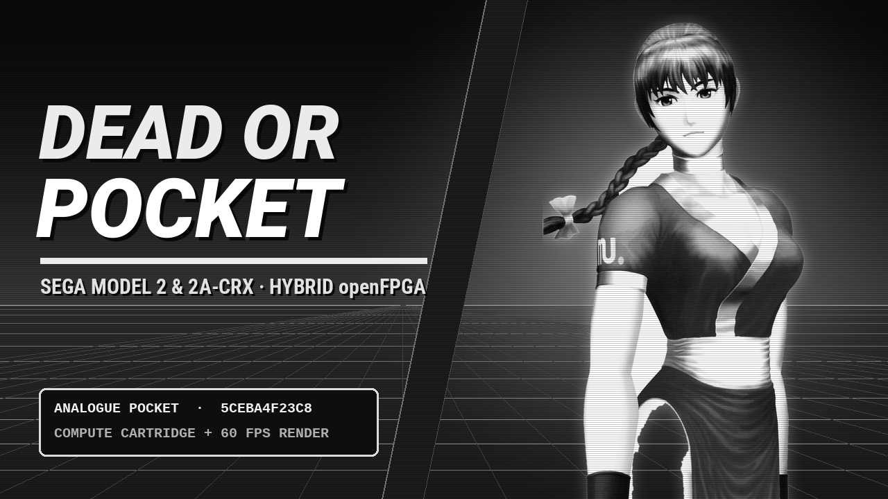
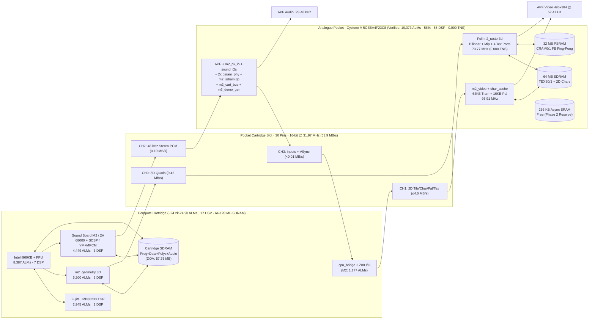

# DeadOrPocket

<p align="center">
  
</p>

**Sega Model 2 & Model 2A-CRX @ 60 fps (57.52 Hz) for Analogue Pocket — Hybrid openFPGA Architecture**

Based on the [`alphanu1/sega-model2-mister`](https://github.com/alphanu1/sega-model2-mister) FPGA recreation (GPL-3.0) and built upon the openFPGA architecture and Cellular PSRAM methodology proven in [`DanimanX/SpaceFish`](https://github.com/DanimanX/SpaceFish).

---

## Phase 1 Milestone — Real `5CEBA4F23C8` Pocket Render Core (100% Timing Closed)

The **Phase 1 Analogue Pocket Render Core** ([`src/fpga/`](src/fpga/)) compiles cleanly in **Intel Quartus Prime 25.1 Lite** targeting the Analogue Pocket's Cyclone V FPGA (`5CEBA4F23C8`) with **0 errors, 0 timing warnings, and 0.000 ns TNS across all four PVT corners (`Slow 85°C`, `Slow 0°C`, `Fast 85°C`, `Fast 0°C`)**:

| Metric (`5CEBA4F23C8`) | Verified Phase 1 Fit | Pocket Ceiling | Utilization |
|---|---:|---:|---:|
| **Logic Utilization (ALMs)** | **10,373** | 18,480 | **56%** |
| **Registers** | **14,149** | — | — |
| **M10K RAM Blocks** | **303** (2,735,996 bits) | 308 (3,153,920 bits) | **98% (87% bits)** |
| **DSP Blocks** | **55** | 66 | **83%** |
| **PLLs** | **2** (`m2_pll` + `m2_audio_pll`) | 4 | **50%** |
| **External Memories Used** | `dram_*` (64 MB) + `cram0_*` (16 MB) + `cram1_*` (16 MB) | + 256 KB Async SRAM free | **Zero DDR3** |

### Verified 4-Corner Static Timing Closure (`pocket_deadorpocket.sta.summary`)

| Clock Domain | Frequency | Slow 85°C Setup | Slow 0°C Setup | Slow 0°C Hold | TNS (All 4 Corners) |
|---|---:|---:|---:|---:|---:|
| `clk_sys` (`m2_raster3d` + FB + Cart Bus) | **73.774 MHz** | `+0.752 ns` | `+0.296 ns` | `+0.122 ns` | **0.000 ns** |
| `clk_mem` (`m2_sdram` 8p + 2×`psram_phy` + `m2_video`) | **95.906 MHz** | `+1.561 ns` | `+1.176 ns` | `+0.166 ns` | **0.000 ns** |
| `clk_cart` (30-pin 16-bit Cart Bus → **63.9 MB/s**) | **31.969 MHz** | `+25.389 ns` | `+25.272 ns` | `+0.491 ns` | **0.000 ns** |
| `clk_pix` (APF Video 496×384 @ 57.47 Hz) | **15.984 MHz** | `+5.069 ns` | `+5.256 ns` | `+0.589 ns` | **0.000 ns** |
| `clk_74a` (APF Bridge / `m2_pk_io`) | **74.250 MHz** | `+4.133 ns` | `+4.432 ns` | `+0.354 ns` | **0.000 ns** |
| `audio_mclk` (48 kHz Stereo I2S DAC) | **12.288 MHz** | `+76.699 ns` | `+76.785 ns` | `+0.325 ns` | **0.000 ns** |

### What Is Included in Phase 1 (`Release/DeadOrPocket_Pocket_v0.1.0-phase1.zip`)

- **Unmodified Full-Fidelity 3D Engine (`m2_raster3d`):** Bilinear texture filtering, mip-mapping, 4 concurrent texel fetch ports, and FTB running natively on the Pocket's `5CEBA4F23C8`.
- **Pixel-Exact 2D Tilemap Pipeline (`m2_video` + `m2_char_cache`):** 4-line scanline ring buffer, 64 KB dual-clock Tile RAM (`u_tram`), 16 KB dual-clock Palette RAM (`u_pal`), and 1K-line character cache backed by 64 MB SDR SDRAM.
- **Zero-Contention Dual-PSRAM Ping-Pong Framebuffer (`m2_fb_psram.sv` + 2× `psram_phy.sv`):** Replaces MiSTer's 32-bit DDR3 framebuffer by packing `m2_raster3d`'s 64-bit 2-pixel beats into 2×16-bit `{hit, RGB555}` words across `cram0_*` (Bank A) and `cram1_*` (Bank B) with zero modifications to `m2_raster3d`.
- **30-Pin Cartridge Slot Synchronous Bus PHY (`m2_cart_bus.sv`):** 16-bit @ 31.97 MHz (**63.9 MB/s**) packet-switched link (`CH0` 3D quads, `CH1` 2D/LUT/texture writes, `CH2` 48 kHz stereo PCM, `CH3` VBlank controller/status TX) with clean hardware level-translator turnaround.
- **Built-in 57.47 Hz 3D Hardware Self-Test (`m2_demo_gen.sv`):** Automatically runs animated 3D shaded quads through the real `m2_raster3d` → Dual-PSRAM FB → APF 496×384 video pipeline on standalone Analogue Pocket hardware when no Compute Cartridge is connected.
- **SpaceFish-Style openFPGA Assets:** Custom monochrome cover (`banner.png`), 36×36 16-bit LE core icon (`icon.bin`), and 521×165 rotated platform artwork (`model2.bin`).

---

## Hybrid Architecture Overview


### Why a Hybrid Architecture? (Phase 0 Quartus 25.1 Verification)

The Analogue Pocket's main Intel Cyclone V FPGA (`5CEBA4F23C8`) provides **18,480 ALMs, 308 M10K blocks, and 66 DSP blocks** (~44% of the MiSTer DE10-Nano's logic fabric). Synthesizing all **16 real RTL subsystems** from both Model 2 (`main`) and Model 2A-CRX (`model2a`) in **Quartus Prime 25.1 Lite** ([`phase0_bench/run_phase0.py`](phase0_bench/run_phase0.py)) proved:

- **A monolithic single-chip port is physically impossible:** even with the entire MiSTer framework (`sys/`) stripped out, the core requires **~34,400–35,100 ALMs (~1.9× the Pocket)**, **~420+ M10K (~1.4×)**, and **~71 DSP (~1.1×)**.
- **The "Compute-in-Cartridge / Render-in-Pocket" split fits cleanly at full 60 fps (57.52 Hz) with zero visual or audio compromises:**
  - **Analogue Pocket (`5CEBA4F23C8`)** runs the complete 3D + 2D video pipeline (`m2_raster3d` + `m2_video`), stores live 2×1 MB texture sheets (`TEXS0`/`TEXS1`) and 2D char RAM in its **64 MB SDR SDRAM**, double-buffers the 3D framebuffer in **ping-pong across both 16 MB Cellular PSRAMs (`cram0`/`cram1`)**, and keeps all **256 KB of Async SRAM (`sram_*`)** free for future expansion — proven in real Quartus 25.1 routing at **56% ALMs (10,373 / 18,480)**, **98% M10K (303 / 308)**, and **83% DSP (55 / 66)**.
  - **Compute Cartridge** (plugged into the Pocket's 30-pin cartridge slot) runs all game computation and audio (`i960KB + FPU`, `MB86233 TGP`, `m2_geometry`, `Sound Board M2/2A`, and `m2_ioz80`), streaming only **~14.2 MB/s peak** of projected quads, 2D deltas, and 48 kHz stereo PCM over the **16-bit synchronous bus @ 31.97 MHz (63.9 MB/s)**.



---

## Installation & Testing (Phase 1 Self-Test on Analogue Pocket)

1. Download [`Release/DeadOrPocket_Pocket_v0.1.0-phase1.zip`](Release/DeadOrPocket_Pocket_v0.1.0-phase1.zip).
2. Extract its contents directly to the root of your Analogue Pocket MicroSD card:
   ```text
   /
   ├── Assets/
   │   └── model2/
   │       ├── common/
   │       └── danimanx.DeadOrPocket/
   │           ├── 3D Hardware Self-Test.json
   │           └── Dead or Alive (Model 2A).json
   ├── Cores/
   │   └── danimanx.DeadOrPocket/
   │       ├── audio.json, core.json, data.json, info.txt, input.json, interact.json, variants.json, video.json
   │       ├── bitstream.rbf_r
   │       └── icon.bin
   └── Platforms/
       ├── _images/
       │   └── model2.bin
       └── model2.json
   ```
3. On your Analogue Pocket, navigate to **openFPGA → Sega Model 2 → DeadOrPocket → 3D Hardware Self-Test** to verify the live 57.47 Hz `m2_raster3d` + Dual-PSRAM Ping-Pong Framebuffer pipeline directly on hardware (no ROMs required).

---

## Building from Source & Verifying ROM Sets

Requirements: Intel Quartus Prime 25.1 Lite with Cyclone V (`5CEBA4F23C8`) and Python 3 (with Pillow for asset regeneration).

```bash
# 1. Compile the full Analogue Pocket Render Core (map + fit + asm + sta)
./tools/build_pocket.sh

# 2. Generate bit-reversed bitstream.rbf_r and Release/DeadOrPocket_Pocket_v0.1.0-phase1.zip
python3 tools/package_pocket.py

# 3. (Optional) Verify local MAME .zip ROM sets placed in roms/ against MRA CRC32s
python3 tools/build_rom.py --verify-all
```

---

## Phase 0 Measured Synthesis Results (`5CEBA4F23C8` · Quartus Prime 25.1 Lite)

Measured directly via [`phase0_bench/run_phase0.py`](phase0_bench/run_phase0.py) (full raw JSON in [`phase0_bench/phase0_parsed.json`](phase0_bench/phase0_parsed.json)):

| RTL Subsystem | Branch | Est. ALMs | Registers | Block Mem Bits | Est. M10K | DSP | Hybrid Side |
|---|---|---:|---:|---:|---:|---:|---|
| `i960_top` (`FP_SUBN=2, RC_RING=1, DC=64`) | `model2a` | **8,387** | 4,519 | 98,304 | 13 | 7 | Cartridge |
| `m2_geometry` | `model2a` | **6,200** | 8,815 | 10,532 | 2 | 3 | Cartridge |
| `m2_copro` (MB86233 TGP) | `model2a` / `main` | **2,945** / 2,644 | 2,863 | 164,098 | 19 / 12 | 1 | Cartridge |
| `m2_2a_sound` (68k + SCSP + DSP) | `model2a` | **4,449** | 3,838 | 228,128 | 40 | 6 | Cartridge (2A) |
| `m2_sound_board` (68k + YM3438 + 2×MPCM) | `main` | **4,307** | 4,130 | 179,571 | 24 | 6 | Cartridge (M2) |
| `m2_ioz80` (TV80 I/O, Model 2 only) | `main` | **1,177** | 783 | 196,608 | 24 | 0 | Cartridge (M2) |
| `m2_cpu_bridge` | `model2a` | **893** | 911 | 169,984 | 17 | 0 | Cartridge |
| `m2_raster3d` (**full: bilinear + mip + FTB**) | `model2a` | **8,228** | 9,724 | 1,944,156 | 208 | 52 | **Pocket** |
| `m2_video` (2D tilemap, 4-line ring) | `model2a` | **1,598** | 2,296 | 122,880 | 16 | 2 | **Pocket** |
| `m2_char_cache` (2K lines) | `model2a` | **202** | 288 | 143,360 | 15 | 0 | **Pocket** |
| `m2_sdram` (8 ports) | `model2a` | **862** | 1,485 | 0 | 0 | 0 | **Pocket** |

See [`docs/ARCHITECTURE.md`](docs/ARCHITECTURE.md) for the full hardware specification: physical cartridge pinout (`apf_top.v`), bus protocol & bandwidth budget, 5V/200 mA power design, candidate cartridge FPGAs (`5CEBA5/7`, `GW5AST-60`, `ECP5-85F`), Cyclone V PLL clock synthesis, and memory maps.

---

## Target Games (Model 2 & Model 2A-CRX)

| Arcade Board | Target Titles |
|---|---|
| **Sega Model 2** | *Daytona USA* (Deluxe '93 & Rev A), *Desert Tank*, *Virtua Cop* |
| **Sega Model 2A-CRX** | *Dead or Alive*, *Virtua Fighter 2*, *Sega Rally Championship*, *Virtua Cop 2*, *Manx TT Superbike*, *Zero Gunner*, *Dynamite Cop*, *Motor Raid*, *Sky Target*, *Pilot Kids*, *Hanguk Pro Yagu 98* |

---

## Roadmap

- [x] **Phase 0:** Feasibility audit against SpaceFish + real Quartus Prime 25.1 Lite (`5CEBA4F23C8`) synthesis benchmark across all 16 Model 2 and Model 2A-CRX subsystems.
- [x] **Phase 1 — Pocket Render Core (`src/fpga/`):** Full Analogue Pocket `5CEBA4F23C8` render core (`m2_raster3d` + `m2_video` + Dual-PSRAM Ping-Pong FB + 8-port SDRAM + 30-pin 16-bit Cart Bus PHY + built-in 3D Self-Test + SpaceFish APF assets), **fitted at 56% ALMs / 98% M10K / 83% DSP with 100% 4-corner timing closure (`0.000 ns TNS`)** and packaged as `DeadOrPocket_Pocket_v0.1.0-phase1.zip`.
- [ ] **Phase 2 — Cartridge Bus Protocol & Verilator Co-Simulation:** Implement the Compute Cartridge RTL TX/RX side (`m2_cart_host.sv`) and co-simulate real Model 2 / Model 2A-CRX ROMs (*Dead or Alive*, *Virtua Fighter 2*, *Sega Rally*, *Daytona USA*) end-to-end across the virtual 30-pin cartridge bus into `m2_pocket_top`.
- [ ] **Phase 3 — Compute Cartridge Hardware Prototype:** Finalize target cartridge FPGA (`5CEBA5/7`, `GW5AST-60`, or `ECP5-85F`), design the 32-pin Pocket cartridge PCB with 64–128 MB SDRAM, high-efficiency buck power stage, and strict 3.3V bus I/O.
- [ ] **Phase 4 — Hardware Bring-Up (Model 2A & Model 2):** Full 57.52 Hz hardware verification across *Dead or Alive*, *Virtua Fighter 2*, *Sega Rally*, and *Daytona USA* (handheld & Dock).

---

## License & Credits

- Hybrid Analogue Pocket architecture & port: **DanimanX**.
- Upstream Sega Model 2 / Model 2A-CRX MiSTer core: **alphanu1** ([`alphanu1/sega-model2-mister`](https://github.com/alphanu1/sega-model2-mister)).
- Reference openFPGA scaffolding & Cellular PSRAM PHY: **SpaceFish** ([`DanimanX/SpaceFish`](https://github.com/DanimanX/SpaceFish)).
- Licensed under the **GNU General Public License v3.0 (GPL-3.0)**. This repository does not contain and will never contain ROM files.
