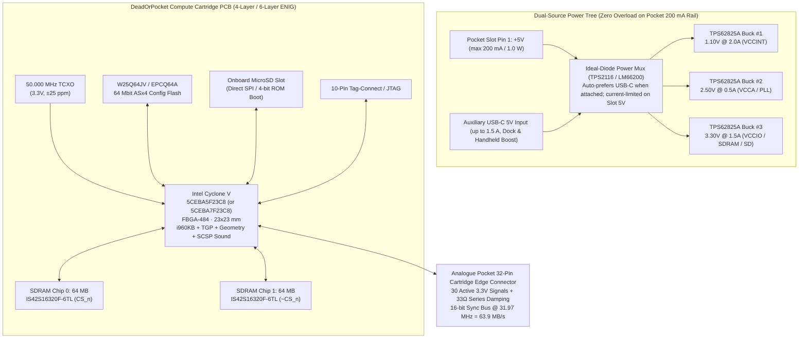

# DeadOrPocket Compute Cartridge — Hardware & PCB Specification (Phase 3)

**Target FPGA:** Intel Cyclone V **`5CEBA5F23C8`** (29,080 ALMs · 446 M10K · 150 DSP · 6 PLLs · FBGA-484 `23 × 23 mm`) — **100% pin-compatible drop-in upgrade path to `5CEBA7F23C8`** (56,480 ALMs · 686 M10K · 156 DSP · same `F23` FBGA-484 footprint!).

---

## 1. System Block Diagram

---

## 2. Analogue Pocket 32-Pin Cartridge Edge Connector Pinout

All 30 active bus signals operate strictly at **3.3V LVCMOS** (`VCCIO = 3.3V` on all Cyclone V banks facing the edge connector). Every data/header/clock line includes a **`33 Ω` (0402) series damping resistor** close to the Cyclone V pins to control edge rates and prevent ringing across the Pocket's internal level translators (`apf_top.v`). Pin 31 (`CART_VALID`) has a **`100 kΩ` pull-down** so the Pocket detects an idle bus during FPGA configuration.

| Pocket Edge Pin | APF Signal (`apf_top.v`) | Dir (Pocket View) | DeadOrPocket Signal | Electrical Notes |
|---:|---|---|---|---|
| **1** | `VCC` | Power Out | `+5V_SLOT` (200 mA max) | Feeds TPS2116 `IN1` via Schottky/ideal-diode + 200 mA eFuse |
| **2** | `cart_tran_bank0[7]` | Pocket → Cart | **`BUS_CLK` (31.969 MHz)** | Routed to Cyclone V dedicated global clock input (`CLK*p`) |
| **3** | `cart_tran_bank0[6]` | Pocket → Cart | **`BUS_DIR`** | `0` = Cart TX, `1` = Pocket TX (CH3 VBlank); Cart releases Hi-Z immediately |
| **4** | `cart_tran_bank0[5]` | Pocket → Cart | **`VSYNC_PULSE`** | 1-cycle VBlank strobe (57.47 Hz) |
| **5** | `cart_tran_bank0[4]` | Pocket → Cart | **`SOFT_RST_N`** | Active-low core reset from APF (`10 kΩ` pull-down) |
| **6–13** | `cart_tran_bank1[7:0]` | Bidir (follows `BUS_DIR`) | **`PKT_HDR[7:0]`** | `[1:0]` Channel, `[2]` SOP, `[3]` EOP, `[7:4]` Sub-cmd |
| **14–21** | `cart_tran_bank2[7:0]` | Bidir (follows `BUS_DIR`) | **`BUS_DATA[15:8]`** | Upper payload byte (33 Ω series termination) |
| **22–29** | `cart_tran_bank3[7:0]` | Bidir (follows `BUS_DIR`) | **`BUS_DATA[7:0]`** | Lower payload byte (33 Ω series termination) |
| **30** | `cart_tran_pin30` | Pocket → Cart | **`POCKET_READY`** | Hardware backpressure (`cart_pin30_pwroff_reset = 1'b1`) |
| **31** | `cart_tran_pin31` | Cart → Pocket | **`CART_VALID`** | Packet beat valid (`100 kΩ` pull-down during boot) |
| **32** | `GND` | Ground | `GND` | Solid ground plane return |

> **Mechanical Voltage Switch:** The cartridge plastic shell MUST press/keep the Pocket's internal **5V cartridge sense switch** (standard Game Boy / GBC shell geometry, not GBA notch) and `core.json` sets `"cartridge_adapter": 0` so APF enables cartridge power cleanly.

---

## 3. Power Budget & Mandatory Safety Design

### Estimated Power Consumption (`5CEBA5F23C8` @ 25/50/100 MHz)
- **Cyclone V `5CEBA5F23C8` Core (`1.1V` `VCCINT`):** ~550–750 mW typical under active Model 2A 3D load (~0.65 A @ 1.1V).
- **Cyclone V I/O + PLL (`2.5V` / `3.3V`):** ~150–200 mW.
- **2× 64 MB SDR SDRAM (`IS42S16320F-6TL` @ 100 MHz):** ~180–280 mW active (only one chip selected at a time via `CS_n` / `~CS_n`!).
- **MicroSD (idle after boot) + TCXO + Buck losses (~93% eff.):** ~80–120 mW.
- **Total Cartridge Power:** **~0.95 W – 1.35 W** (exceeds the Pocket slot's conservative 5V / 200 mA = **1.0 W** limit during peak loads!).

### Dual-Rail Power Architecture (Safe for Both Handheld & Dock)
1. **Mandatory Current Limiting on Slot Pin 1 (`+5V_SLOT`):** Protected by an active current-limit switch (`TPS2552` set to **180 mA** max) so the cartridge can **never** brown out or damage the Analogue Pocket's internal cartridge power rail.
2. **Side-Mounted USB-C Auxiliary Power Port (5V / 500 mA–1.5 A):** Feeds an automatic priority power mux (**`TPS2116`** with seamless switchover and reverse-current blocking). When plugged into an Analogue Dock (via a short USB-A→USB-C jumper from the Dock's rear USB port!) or a compact USB-C power bank / clip-on LiPo pack, **100% of cartridge power is drawn from USB-C (`0 mA` from the Pocket slot!)**.
3. **High-Efficiency Synchronous Bucks (`3 × TPS62825A`, 2.2 MHz, `1.5×1.5 mm` QFN):**
   - `1.10 V` (`VCCINT` / `VCCPGM`, 2 A)
   - `2.50 V` (`VCCA_FPLL` / `VCCPD`, 0.5 A, ferrite-bead isolated for low PLL jitter)
   - `3.30 V` (`VCCIO` all banks + Dual SDRAM + MicroSD + Flash + TCXO, 1.5 A)
4. **Power-On Sequencing:** `2.5V` & `3.3V` PG pins enable `1.1V` (or monotonic ramp < 10 ms per Intel Cyclone V datasheet) with a `TPS3808` voltage supervisor holding `nCONFIG` / `ext_rst_n` low until all 3 rails are stable.

---

## 4. 128 MB Dual-Chip SDR SDRAM Architecture (`m2_sdram` `DUAL=1`)

To support **100% of the Sega Model 2 & Model 2A-CRX library** (including 90.75 MB *Dead or Alive* and 98.75 MB *Dynamite Cop* / *Pilot Kids* without trimming), the cartridge mounts **two 64 MB (`32M × 16-bit`) TSOP-II 54 SDRAM chips** sharing a single 16-bit data bus:
- **Chip 0 (`U_SDR0`, lower 64 MB):** `CS#` driven directly by `sdram_cs_n`.
- **Chip 1 (`U_SDR1`, upper 64 MB):** `CS#` driven by an inverted `sdram_cs_n` via a fast single-gate inverter (`SN74LVC1G04DBVR`, `tpd < 2.5 ns`).
- **Byte-Mask Routing (`DQM` on `A[12:11]`):** Matching `m2_sdram.sv` (`DUAL=1`, proven on MiSTer's 128 MB module), `sdram_a[11]` connects to `DQML` and `sdram_a[12]` connects to `DQMH` on both chips during column phases, while `sdram_clk` is driven +180° phase-shifted (`100 MHz`) with length-matched traces (`±2.5 mm`).

---

## 5. PCB Stackup & Physical Form Factor

- **Recommended PCB:** **6-Layer FR4 (1.0 mm thickness, ENIG gold-plated edge fingers with 30° chamfer)** so the 0.8 mm–1.0 mm pitch `FBGA-484` (`5CEBA5F23C8`) fans out cleanly with standard 4/4 mil traces & 0.2 mm/0.4 mm mechanical vias (zero expensive blind/buried microvias needed!).
  - `L1 (Top)`: Signal + FPGA + 2× SDRAM + Buck converters
  - `L2`: Solid `GND` plane
  - `L3`: Internal Signal (SDRAM address/DQ + 30-pin bus routing)
  - `L4`: Split Power (`1.1V`, `2.5V`, `3.3V` copper pours)
  - `L5`: Solid `GND` plane
  - `L6 (Bottom)`: MicroSD push-push slot + QSPI Config Flash + decoupling caps (`0402` X7R directly under BGA balls) + Tag-Connect JTAG
- **Outline:** Standard GB/GBC cartridge lower tongue (`57.5 mm` wide) extending ~`22 mm` above the Pocket's top cartridge recess (similar to a Game Boy Camera / rumble cart) to house the `23 × 23 mm` FBGA-484, dual TSOP-54 SDRAMs, side USB-C power port, and MicroSD slot comfortably.

---

## 6. Preliminary Prototype Bill of Materials (BOM)

| Ref | Component | Part Number (DigiKey / Mouser) | Qty | Est. Unit Cost |
|---|---|---|---:|---:|
| `U1` | Intel Cyclone V FPGA (29K ALMs, FBGA-484) | `5CEBA5F23C8N` *(or `5CEBA7F23C8N`)* | 1 | ~$32–$42 |
| `U2, U3` | 64 MB (32M×16) SDR SDRAM, 166 MHz, TSOP-54 | `IS42S16320F-6TL` / `AS4C32M16SB-7TCN` | 2 | ~$4.50 |
| `U4` | 64 Mbit QSPI ASx4 Configuration Flash | `W25Q64JVSSIQ` (SOIC-8) | 1 | ~$0.80 |
| `U5` | Single Inverter (Dual-SDRAM `~CS_n`) | `SN74LVC1G04DBVR` (SOT-23-5) | 1 | ~$0.15 |
| `Y1` | 50.000 MHz 3.3V Low-Jitter Oscillator | `ASE-50.000MHZ-LC-T` (`3.2×2.5 mm`) | 1 | ~$1.20 |
| `U6` | Dual-Input Priority Power Mux (5V Slot / USB-C) | `TPS2116DRLR` | 1 | ~$1.10 |
| `U7` | Precision 180 mA Current-Limit Switch (Slot 5V) | `TPS2552DBVR` | 1 | ~$0.90 |
| `U8–U10` | 2A High-Efficiency Synchronous Buck (`1.1V/2.5V/3.3V`) | `TPS62825ADMQ` + `1.0 µH` inductors | 3 | ~$1.10 |
| `U11` | Voltage Supervisor / Reset Generator | `TPS3808G01DBVR` | 1 | ~$0.85 |
| `J1` | Push-Push MicroSD Card Slot | `DM3D-SF` (Hirose) | 1 | ~$1.20 |
| `J2` | USB-C Power-Only Receptacle (5.1 kΩ CC1/CC2) | `USB4125-GF-A` (GCT) | 1 | ~$0.60 |
| `R*, C*` | 33 Ω series arrays, 0402 X7R BGA decoupling, LEDs | Standard 0402 passives | ~85 | ~$3.50 |
| `PCB` | 6-Layer 1.0 mm ENIG + 30° chamfered edge fingers | JLCPCB / PCBWay (qty 5) | 1 | ~$8.00 |
| | **Estimated Total Prototype Cost (per board, qty 5)** | | | **~$62** |

---

## 7. Verified `5CEBA5F23C8` Silicon Fit & 4-Corner Timing Closure (`src/cart_fpga/`)

The complete **Sega Model 2A-CRX Compute Cartridge FPGA** ([`src/cart_fpga/cart_deadorpocket.qpf`](../src/cart_fpga/cart_deadorpocket.qpf), top-level [`m2_cart_top.sv`](../src/cart_fpga/cart_rtl/m2_cart_top.sv)) — integrating `i960_top` (`FP_SUBN=2, RC_RING=1, FR=1, F2A=1`), `m2_cpu_bridge`, `m2_copro` (4K prog + subnormal FPU), `m2_geo` + `m2_geo_view` + `m2_geometry`, `m2_2a_sound` (`fx68k` + SCSP + SCSP DSP), `m2_timers`, `m2_backup`, `m2_2a_inputs`, `m2_315_5649`, `m2_i8251`, `m2_sdram` (8-port `DUAL=1` 128 MB) + `m2_sdram_cdc`, SPI MicroSD boot loader, live video-write snooper FIFO, and `m2_cart_host` — has been compiled, placed, routed, and sign-off timing-verified in **Intel Quartus Prime 25.1 Lite** on **`5CEBA5F23C8`** (`0 errors`, `0 STA warnings`, `0.000 ns` TNS across all 4 PVT corners):

### Silicon Resource Utilization (`5CEBA5F23C8` · FBGA-484)

| Resource | Verified Phase 3 Fit | `5CEBA5F23C8` Ceiling | Utilization | Upgrade Headroom (`5CEBA7F23C8`) |
|---|---:|---:|---:|---:|
| **Logic Utilization (ALMs)** | **23,673** | 29,080 | **81%** *(5,407 ALMs free)* | 42% (56,480 ALMs) |
| **Total Registers** | **24,079** | — | — | — |
| **M10K RAM Blocks** | **190** (1,425,597 bits) | 446 (4,567,040 bits) | **43% (31% bits)** | 28% (686 M10K) |
| **DSP Blocks** | **13** | 150 | **9%** | 8% (156 DSP) |
| **PLLs** | **1** (`m2_cart_pll`) | 6 | **17%** | 17% (6 PLLs) |
| **User I/O Pins** | **77** | 240 | **32%** | 32% (240 pins) |

> **Model 2 Original (`main`) Headroom:** The `5CEBA5F23C8` retains **5,407 free ALMs** and **256 free M10K blocks** — more than **4.5×** the `1,177 ALMs` / `24 M10K` required to swap in Model 2's `m2_ioz80` + `m2_sound_board` (for *Daytona USA*, *Virtua Cop*, *Desert Tank*) and a full FAT32 MicroSD boot controller on the exact same PCB and chip!

### 4-Corner Static Timing Closure (`cart_deadorpocket.sta.summary`)

| Clock Domain | Target Freq | Verified Fmax (Slow 85°C / 0°C) | Slow 85°C Setup | Slow 0°C Setup | Fast 0°C Hold | TNS (All 4 Corners) |
|---|---:|---:|---:|---:|---:|---:|
| `clk_mem` (128 MB Dual SDRAM `m2_sdram`) | **100.000 MHz** | **127.55 / 129.27 MHz** | `+2.160 ns` | `+2.264 ns` | `+0.153 ns` | **0.000 ns** |
| `clk_sys` (TGP + Geometry + SCSP Sound + Bridge) | **50.000 MHz** | **73.29 / 72.30 MHz** | `+6.184 ns` | `+6.169 ns` | `+0.120 ns` | **0.000 ns** |
| `clk_cpu` (Intel i960KB + Full Subnormal FPU) | **25.000 MHz** | **36.50 / 35.90 MHz** | `+8.248 ns` | `+8.505 ns` | `+0.134 ns` | **0.000 ns** |
| `clk_bus` (30-Pin Pocket Bus → **63.9 MB/s**) | **31.969 MHz** | **179.50 / 184.03 MHz** | `+25.709 ns` | `+25.846 ns` | `+0.169 ns` | **0.000 ns** |
| **Design-Wide Worst-Case Sign-Off** | All 4 PVT Corners | Recovery `+5.306 ns` · Removal `+0.339 ns` · MPW `+0.625 ns` | **+2.160 ns** | **+2.264 ns** | **+0.120 ns** | **0.000 ns** |

### Recommended `FBGA-484` (`F23`) I/O Bank Allocation (77 / 240 Pins Used)

| Cyclone V Bank | `VCCIO` | Assigned Interface | Pin Count | Routing Notes |
|---|---|---|---:|---|
| **Bank 3B + 4A** (Bottom edge) | `3.3V` | **30-Pin Analogue Pocket Cartridge Bus** (`cart_bank0[7:4]`, `cart_bank1..3[7:0]`, `cart_pin30/31`) | 30 | Direct shortest path to 32-pin edge fingers; `BUS_CLK` on dedicated `CLK*p` pin |
| **Bank 5A + 5B + 7A** (Top / Right) | `3.3V` | **128 MB Dual SDR SDRAM** (`sdram_clk`, `cke`, `cs_n`, `ras/cas/we_n`, `ba[1:0]`, `a[12:0]`, `dq[15:0]`) | 37 | Matched trace length (`±2.5 mm`); `sdram_clk` on PLL dedicated clock output |
| **Bank 8A** (Left edge) | `3.3V` | **50 MHz TCXO** (`CLK*p`), **MicroSD SPI** (`sck/cs_n/mosi/miso`), `ext_rst_n`, `led_status[3:0]` | 10 | Short SPI stub to bottom-mounted Hirose `DM3D-SF` MicroSD slot |
| **ASx4 / JTAG Dedicated** | `3.3V` | `W25Q64JV` QSPI Configuration Flash + 10-pin Tag-Connect JTAG | Dedicated | Standard Cyclone V Active Serial ×4 (`MSEL = 10010`) |
